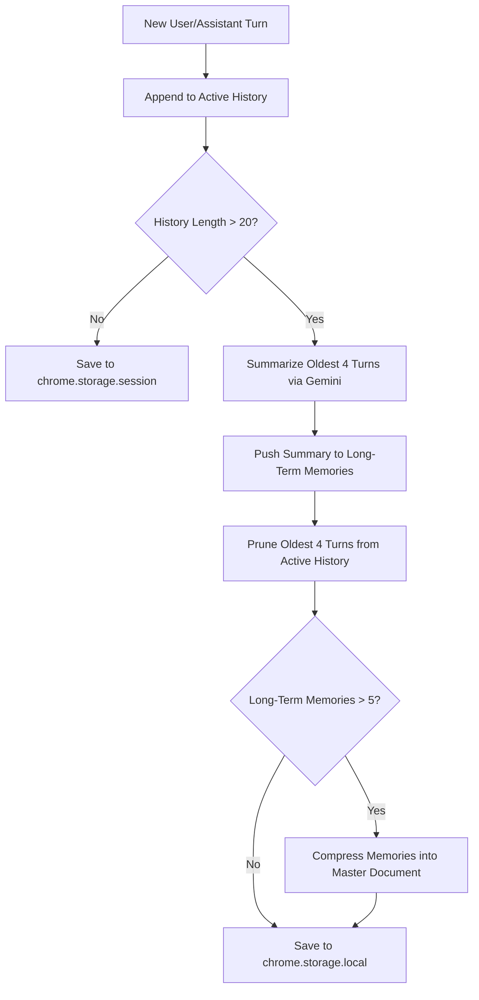

# ANVORA: Autonomous Intelligence
## Complete Technical Architecture & System Documentation

**Version:** `1.1.0`  
**Descriptor:** AUTONOMOUS INTELLIGENCE  
**Tagline:** Connected Intelligence. Autonomous Action.  
**Target Platform:** Chromium-based browsers (Google Chrome, Microsoft Edge, Brave)  
**Specification:** Chrome Extensions Manifest V3 (MV3)  
**Primary Language:** TypeScript (ES2023, Modern Bundler Mode)  
**Build System:** Vite 8.0.x with `@crxjs/vite-plugin`  
**License:** MIT  

> **Heritage & Attribution:** ANVORA is developed upon the architecture of the open-source *Lucy* browser assistant created by Shreyas (MIT License), retaining its deterministic state machine and DOM grounding while extending it with multimodal reasoning, Liquid Glass UI, multilingual intelligence, fast-path routing, and proactive automation.

---

## Table of Contents
1. [Executive Summary & System Objectives](#1-executive-summary--system-objectives)
2. [High-Level Architecture & Component Topology](#2-high-level-architecture--component-topology)
3. [Manifest V3 Configuration & Extension Permissions](#3-manifest-v3-configuration--extension-permissions)
4. [Deterministic State Machine Architecture](#4-deterministic-state-machine-architecture)
5. [Agent Manager & Multi-Agent Orchestration](#5-agent-manager--multi-agent-orchestration)
6. [Intent Classification & Safety Guardrails](#6-intent-classification--safety-guardrails)
7. [Autonomous DOM Interaction Engine](#7-autonomous-dom-interaction-engine)
8. [Set-of-Marks (SoM) Interactive Element Harvesting](#8-set-of-marks-som-interactive-element-harvesting)
9. [Semantic Page Context & TreeWalker Extraction](#9-semantic-page-context--treewalker-extraction)
10. [Autonomous Overlay & Cookie Banner Dismissal](#10-autonomous-overlay--cookie-banner-dismissal)
11. [Multimodal Vision & Screen Inspection](#11-multimodal-vision--screen-inspection)
12. [LLM Client, Task Queuing & Rate Limiting](#12-llm-client-task-queuing--rate-limiting)
13. [Dual-Tier Memory & Context Compaction Engine](#13-dual-tier-memory--context-compaction-engine)
14. [Speech Pipeline: Dual STT & Serialized TTS](#14-speech-pipeline-dual-stt--serialized-tts)
15. [Background Service Worker & Tab Management](#15-background-service-worker--tab-management)
16. [Sidepanel User Interface & Audio Visualization](#16-sidepanel-user-interface--audio-visualization)
17. [Options Page & Permissions Onboarding](#17-options-page--permissions-onboarding)
18. [Landing Page & Showcase Architecture](#18-landing-page--showcase-architecture)
19. [Error Recovery, Edge Cases & Safeguards](#19-error-recovery-edge-cases--safeguards)
20. [Project Directory Layout & Module Reference](#20-project-directory-layout--module-reference)
21. [Build, Deployment & Verification](#21-build-deployment--verification)

---

## 1. Executive Summary & System Objectives

**ANVORA** is an open-source, voice-first autonomous browser assistant engineered specifically for accessibility, hands-free navigation, and assistive technology for blind and visually impaired users.

### Core Distinctions from Traditional Screen Readers
1. **Semantic Agency vs. Sequential Narration:** Traditional screen readers (such as JAWS, NVDA, or ChromeVox) sequentially read out DOM nodes in document order, requiring users to repeatedly press Tab or arrow keys through hundreds of navigational links, cookie banners, and irrelevant elements. ANVORA treats the web page as an interactive environment, extracting high-level semantics and performing multi-step actions autonomously.
2. **Deterministic State Machine:** All interactions, transitions, retries, and task loops are governed by a formal state machine that prevents race conditions, handles interruptions gracefully, and terminates runaway loops.
3. **Set-of-Marks (SoM) Visual Prompting:** Instead of feeding raw HTML or complex DOM trees to the Language Model (which floods token context windows and induces hallucinations), ANVORA numbers all visible, clickable, and typable elements on the screen with spatial quadrant metadata.
4. **Natural Audio Feedback ("Thinking Out Loud"):** ANVORA generates natural spoken audio using the browser's native speech synthesis engine while actions are executing, providing auditory reassurance to visually impaired users without leaking internal system logs.
5. **Multimodal Visual Verification:** When text extraction is ambiguous or layout verification is required, ANVORA takes active tab screenshots and submits them to Google Gemini's multimodal vision endpoint to inspect page state before taking subsequent actions.

---

## 2. High-Level Architecture & Component Topology

The system operates across three distinct execution contexts defined by the Chromium Extension sandbox:

```mermaid
graph TD
    subgraph Chromium Browser Sandbox
        subgraph Sidepanel UI Context
            UI[Sidepanel DOM & Audio Waveform]
            STT[Web Speech STT / Groq Whisper]
            TTS[Web Speech Synthesis Queue]
            SM[Deterministic State Machine]
            AM[Agent Manager Coordinator]
            HM[Dual-Tier History Manager]
            LLM[Gemini API Client & Queue]
        end

        subgraph Background Service Worker
            SW[background.ts Service Worker]
            TM[Tab Manager & Navigation]
            AD[Audio Ducking & Muting]
            HK[Global Commands & Hotkeys]
        end

        subgraph Content Script Context
            CS[content.ts Content Script]
            SOM[Set-of-Marks Harvester]
            TW[TreeWalker Semantic Extractor]
            OV[Overlay & Cookie Dismissal]
            DOM[DOM Action Dispatcher]
        end

        subgraph Worker Agent Context
            WA[WorkerAgent Sub-Agent]
        end
    end

    User([User Voice]) -->|Audio Input| STT
    STT -->|Transcript| AM
    AM -->|Transitions| SM
    SM -->|State Changes| UI
    AM -->|Context Request| CS
    CS -->|Metadata, Semantic Text, Markers| AM
    AM -->|User Intent & History| LLM
    LLM -->|Classification & Action Plan| AM
    AM -->|Execute Content Action| CS
    AM -->|Execute Tab/Navigation Action| SW
    AM -->|Delegate Complex Subtask| WA
    WA -->|Subtask Execution & Results| AM
    AM -->|Spoken Thought & Answer| TTS
    TTS -->|Audio Output| User
    SW -->|Mute / Unmute Tabs| AD
```



### Execution Flow Summary
1. **User Voice Input:** The user speaks via `Ctrl+Space` (push-to-talk) or by clicking the Siri-style orb in the sidepanel.
2. **Audio Transcription:** Audio is transcribed via browser-native `webkitSpeechRecognition` with real-time interim results. Optionally, if configured with a Groq API key, high-accuracy transcription is performed using `whisper-large-v3-turbo`.
3. **Intent Classification:** The transcript is analyzed against current URL, page title, user background context (location, preferences, shortcuts), and recent conversation history to categorize intent into `task`, `generic`, `confirmation`, or `cancellation`.
4. **Safety & Ambiguity Evaluation:** High-risk actions (financial transactions, emails, account deletions) require explicit user confirmation. Ambiguous commands trigger conversational clarifying questions.
5. **Action Planning:** The planner LLM analyzes current DOM interactive markers, partial semantic text, and history to formulate an atomic browser action.
6. **Execution & DOM Settle:** Actions are routed either to the Content Script (for in-page clicks, typing, scrolling, media control) or the Background Service Worker (for navigation, tab switching, opening, or closing). Content scripts wait for DOM mutations to settle before reporting success.
7. **Verification & Loop Termination:** The planner inspects the updated page state (or requests a screenshot for visual confirmation) and continues until the goal is accomplished or the 10-step safety limit is reached.

---

## 3. Manifest V3 Configuration & Extension Permissions

The extension is declared via `manifest.json` under Chrome Extension Manifest V3 specifications.

```json
{
  "manifest_version": 3,
  "name": "ANVORA",
  "version": "1.1.0",
  "description": "ANVORA: Autonomous Intelligence — Connected Intelligence. Autonomous Action.",
  "icons": {
    "128": "public/icon.png"
  },
  "permissions": [
    "sidePanel",
    "tabs",
    "storage",
    "scripting",
    "activeTab",
    "webNavigation",
    "commands"
  ],
  "host_permissions": [
    "<all_urls>"
  ],
  "background": {
    "service_worker": "src/background/background.ts",
    "type": "module"
  },
  "side_panel": {
    "default_path": "src/sidepanel/index.html"
  },
  "options_ui": {
    "page": "src/options/options.html",
    "open_in_tab": true
  },
  "action": {
    "default_title": "ANVORA",
    "default_icon": "public/icon.png"
  },
  "content_scripts": [
    {
      "matches": ["<all_urls>"],
      "js": ["src/content/content.ts"],
      "run_at": "document_idle"
    }
  ],
  "commands": {
    "_execute_side_panel": {
      "suggested_key": {
        "default": "Ctrl+Shift+Y",
        "mac": "Command+Shift+Y"
      },
      "description": "Open ANVORA Sidepanel"
    },
    "toggle-listening": {
      "suggested_key": {
        "default": "Ctrl+Space"
      },
      "description": "Push-to-talk: hold to speak"
    }
  }
}
```

### Permission Justification & Security Boundaries
- `sidePanel`: Houses the persistent agent interface alongside active web pages without obscuring page content.
- `tabs`: Allows the assistant to query, list, switch, create, close, and navigate browser tabs on behalf of the user.
- `storage`: Provides partitioned storage: `chrome.storage.session` for short-term chat logs and `chrome.storage.local` for persistent user preferences and long-term memories.
- `scripting`: Dynamically executes content inspection scripts (such as DOM mutation observers across page reloads).
- `activeTab`: Grants temporary host permission to capture visible tab screenshots for multimodal vision analysis.
- `webNavigation`: Tracks tab lifecycle events and document readiness.
- `commands`: Binds system-wide keyboard shortcuts (`Ctrl+Shift+Y` to toggle sidepanel, `Ctrl+Space` for push-to-talk).
- `host_permissions: ["<all_urls>"]`: Enables the content script to execute on any webpage the user navigates to.

---

## 4. Deterministic State Machine Architecture

File: `src/lib/state-machine.ts`

ANVORA enforces a formal state transition graph implemented as a deterministic finite-state automaton. Any transition not explicitly registered in the transition table is rejected, logged, and prevented from causing runtime instability.

### State Space Definition
```typescript
export type AgentState =
  | 'IDLE'               // Standby, waiting for voice input or hotkey
  | 'LISTENING'          // Microphone active, capturing audio
  | 'TRANSCRIBING'       // Converting captured audio via STT
  | 'CLASSIFYING'        // Analyzing user intent, ambiguity, and risk
  | 'RESPONDING'         // Generating and speaking a conversational response
  | 'PLANNING'           // Computing the next atomic browser action
  | 'EXECUTING'          // Dispatching action to Content Script or Background Worker
  | 'WAITING_FOR_REPLY'  // Blocked awaiting user confirmation or clarification
  | 'WAITING_FOR_WORKER' // Coordinator waiting for sub-agent worker completion
  | 'REPLANNING'         // Recovering from a failed DOM action
  | 'RECOVERING'         // Handling fatal exceptions or consecutive failures
  | 'COMPLETE';          // Goal achieved, speaking final confirmation
```

### Formal Transition Matrix
| Source State (`from`) | Permitted Target States (`to`) |
|---|---|
| `IDLE` | `LISTENING`, `CLASSIFYING`, `IDLE` |
| `LISTENING` | `TRANSCRIBING`, `IDLE` |
| `TRANSCRIBING` | `CLASSIFYING`, `IDLE` |
| `CLASSIFYING` | `RESPONDING`, `PLANNING`, `WAITING_FOR_REPLY`, `IDLE`, `RECOVERING` |
| `RESPONDING` | `IDLE`, `RECOVERING` |
| `PLANNING` | `EXECUTING`, `WAITING_FOR_WORKER`, `IDLE`, `RECOVERING`, `COMPLETE` |
| `EXECUTING` | `PLANNING`, `REPLANNING`, `COMPLETE`, `RECOVERING`, `IDLE` |
| `WAITING_FOR_REPLY` | `CLASSIFYING`, `IDLE` |
| `WAITING_FOR_WORKER`| `PLANNING`, `COMPLETE`, `RECOVERING`, `IDLE` |
| `REPLANNING` | `PLANNING`, `RECOVERING`, `IDLE` |
| `RECOVERING` | `IDLE` |
| `COMPLETE` | `IDLE` |

### State Machine Lifecycle Hooks & Protections
1. **Busy State Exit Hook (`onExitBusy`):** When leaving busy execution states (`EXECUTING`, `PLANNING`, or `REPLANNING`), the state machine automatically triggers `onExitBusy()`, which signals an `AbortController` to cancel in-flight HTTP requests and DOM timers immediately.
2. **Reply Timeout Guard (`WAIT_TIMEOUT_MS = 60_000`):** When in `WAITING_FOR_REPLY` (such as asking for clarification or confirmation), an automatic 60-second timer runs. If the user does not respond within 60 seconds, ANVORA calls `onWaitTimeout()`, speaks *"Let me know when you're ready."*, and cleanly resets to `IDLE`.
3. **Transition Audit Log:** Maintains a ring buffer of the last 20 state transitions (`TransitionEntry[]`) with timestamps for diagnostic introspection via the sidepanel debug drawer.

---

## 5. Agent Manager & Multi-Agent Orchestration

File: `src/lib/agent-manager.ts` and `src/lib/worker-agent.ts`

The `AgentManager` serves as the central brain orchestrating the speech pipeline, state machine, LLM client, DOM interactions, and history manager.

### Core Lifecycle Methods
- `configure(config: LLMConfig, bgCtx?: BackgroundContext)`: Initializes the API configuration, registers background context (user name, preferences, shortcuts, location), and loads history asynchronously.
- `handleTranscript(transcript: string)`: Primary entry point for spoken user inputs. Handles interruptions, state guards, intent classification, and routing.
- `handleReply(transcript: string, snap: StateSnapshot)`: Specialized fast-path handler invoked when the agent is waiting in `WAITING_FOR_REPLY`. Avoids full classification re-entry and directly resolves confirmation ("yes"), cancellation ("stop"), or brand new tasks.
- `executeTask(taskSummary: string, signal: AbortSignal)`: Autonomous execution loop driving multi-step browser tasks up to a maximum of 10 steps.

### Multi-Agent Delegation: The WorkerAgent Subsystem
When a browser task requires complex, multi-step deep research (e.g., searching across multiple articles or comparing items), the planner can emit the `spawn_worker` action primitive:
```typescript
if (action.action === 'spawn_worker' && action.text) {
  this.machine.transition('WAITING_FOR_WORKER', {
    message: 'Delegating to background worker...',
    stepCount,
    consecutiveFailures,
  });
  this.onSpeak?.(action.thought || "I've assigned a worker to look into that. Give me a moment...");
  
  const worker = new WorkerAgent(`worker-${stepCount}`, this.llmConfig, this.bgCtx);
  worker.onExecuteAction = this.onExecuteAction;
  worker.onGetContext = this.onGetContext;
  worker.onGetScreenshot = this.onGetScreenshot;
  
  await worker.init();
  const workerResult = await worker.executeTask(action.text);
  
  await this.history.addTurn('assistant', `[INTERNAL SYSTEM LOG] Worker reported:\n${workerResult}`, this.llmConfig);
  continue; // Coordinator re-evaluates the worker's report to formulate the final answer
}
```

#### Worker Agent Isolation Rules:
- **Isolated History:** Workers operate with their own freshly created `HistoryManager` to prevent polluting the coordinator's primary conversational memory.
- **Extended Step Budget:** Workers are allocated up to 15 execution steps to complete in-depth subtasks.
- **Recursion Prevention:** Workers are strictly forbidden from spawning nested workers (`spawn_worker` emitted by a worker immediately triggers a recovery failure).

---

## 6. Intent Classification & Safety Guardrails

File: `src/lib/classifying.ts`

Before any DOM action is planned, every user utterance passes through a lightweight, zero-latency classifier prompt:

```typescript
export interface Classification {
  intent_evaluation: string;
  type: 'generic' | 'task' | 'confirmation' | 'cancellation';
  ambiguity: 'clear' | 'ambiguous';
  scope: 'single' | 'multi-step';
  risk: 'low' | 'high';
  summary: string;
  clarification_question: string | null;
}
```

### Critical Classifier Logic
1. **Phonetic STT Error Correction:** The classifier prompt explicitly instructs the LLM:
   > *"Evaluate if there are phonetic Speech-to-Text errors. If the literal text makes no logical sense in the current environment but a phonetically similar phrase does, state the correction."*
   For example, if speech recognition outputs *"go to ready dot com"* while discussing Reddit, the model evaluates the phonetic error and corrects the target to `reddit.com`.
2. **Four Distinct Intent Types:**
   - `confirmation`: Answering "yes", "sure", "go ahead" to a pending assistant question.
   - `cancellation`: Answering "no", "stop", "abort", or "cancel".
   - `task`: Executable browser navigation, clicking, typing, searching, or querying.
   - `generic`: Conversational small-talk, greetings, or questions answered without browser actions.
3. **Risk Boundaries:**
   - **HIGH Risk:** Actions involving financial transactions, sending emails/messages, account deletion, or irreversible changes. Automatically triggers `WAITING_FOR_REPLY` with an explicit verbal confirmation challenge: *"Just to be safe, you want me to [action]. Should I go ahead?"*
   - **LOW Risk:** Standard navigation, searching, reading content, clicking links, media playback.
4. **Ambiguity Gate:** If the user request is underspecified and proceeding could yield the wrong outcome, `ambiguity` is flagged as `ambiguous`, and the agent pauses execution to ask the generated `clarification_question`.

---

## 7. Autonomous DOM Interaction Engine

File: `src/content/content.ts` and `src/lib/dom-utils.ts`

When an action is dispatched to the active page's content script (`EXECUTE_ACTION`), it is executed by the content script's DOM action engine.

### Supported Action Primitives

| Action Primitive | Parameters | Target Context | Behavior |
|---|---|---|---|
| `click` | `target_id` | Content Script | Smooth scrolls element to center, focuses it, dispatches full mouse event cascade (`pointerdown`, `mousedown`, `pointerup`, `mouseup`, `click`), and calls `.click()`. Toggles `<video>`/`<audio>` if clicked. |
| `type` | `target_id`, `text`, `submit?` | Content Script | Smooth scrolls, focuses, selects all existing content (Ctrl+A / `selectAll`), inserts text via `document.execCommand('insertText')` or native property descriptor setter, triggers `input`/`change`/`keyup` events. If `submit: true`, dispatches Enter key cascade and calls `form.requestSubmit()`. |
| `press_enter` | None | Content Script | Dispatches Enter key event sequence to `document.activeElement` and calls `requestSubmit()` on any containing `<form>`. |
| `press_key` | `text` (key name) | Content Script | Dispatches `keydown`, `keypress`, `keyup` on the `document` (e.g. "Escape" to close overlays). |
| `scroll_down` | `text?: "small"\|"medium"\|"large"` | Content Script | Smoothly scrolls down by a fraction of window height (small: 0.2x, medium: 0.5x, default: 0.8x). |
| `scroll_up` | `text?: "small"\|"medium"\|"large"` | Content Script | Smoothly scrolls up by a fraction of window height. |
| `media` | `text: "play"\|"pause"\|"mute"\|"unmute"` | Content Script | Queries all `<video>` and `<audio>` tags on the page and modifies their playback or muted states directly. |
| `wait` | None | Content / Background | Delays execution by 3000ms to allow asynchronous operations to complete. |
| `navigate` | `url` | Background Worker | Normalizes protocol (`https://`), calls `chrome.tabs.update()`, and waits for tab status `complete` plus 500ms DOM silence. |
| `go_back` | None | Background Worker | Calls `chrome.tabs.goBack()`. |
| `list_tabs` | None | Background Worker | Queries all tabs in current window, returns formatted string `[Tab <id>] <title> - <url>` to agent memory. |
| `switch_tab` | `tab_id` | Background Worker | Activates target tab via `chrome.tabs.update(tab_id, { active: true })`. |
| `close_tab` | `tab_id` | Background Worker | Removes target tab via `chrome.tabs.remove(tab_id)`. |
| `new_tab` | `url` | Background Worker | Creates new tab via `chrome.tabs.create({ url })`. |
| `answer` | `text` | Sidepanel | Final answer to user query extracted from page text; spoken aloud via TTS. |
| `done` | None | Sidepanel | Signals full completion of the task. |
| `fail` | `reason` | Sidepanel | Signals task failure and explains reason to user. |
| `spawn_worker` | `text` (subtask instructions) | Sidepanel / Worker | Delegates multi-step subtask to background `WorkerAgent`. |

### Human-Like Input Synthesis (`fillInput`)
Modern web frameworks (React, Angular, Vue, Svelte) and rich text editors (Monaco, CodeMirror) intercept input value changes and ignore basic `element.value = "text"` assignments. ANVORA bypasses framework synthetic event suppression using a multi-stage input pipeline:
```typescript
export function fillInput(element: HTMLInputElement | HTMLTextAreaElement, value: string) {
  element.focus();
  element.select();
  
  // Select all existing text across complex editors
  element.dispatchEvent(new KeyboardEvent('keydown', { key: 'a', code: 'KeyA', ctrlKey: true, bubbles: true }));
  element.dispatchEvent(new KeyboardEvent('keydown', { key: 'a', code: 'KeyA', metaKey: true, bubbles: true }));
  document.execCommand('selectAll', false, undefined);
  
  // Try execCommand first for realistic keystrokes and undo stack preservation
  const success = document.execCommand('insertText', false, value);
  
  if (!success) {
    // Bypass React's overridden value setter by extracting the native prototype setter
    const nativeSetter = Object.getOwnPropertyDescriptor(
      Object.getPrototypeOf(element), 'value'
    )?.set;

    if (nativeSetter) {
      nativeSetter.call(element, value);
    } else {
      element.value = value;
    }
  }

  // Dispatch standard DOM events to trigger reactive state updates
  element.dispatchEvent(new Event('input', { bubbles: true }));
  element.dispatchEvent(new Event('change', { bubbles: true }));
  element.dispatchEvent(new KeyboardEvent('keyup', { bubbles: true }));
}
```

### Asynchronous DOM Mutation Settle (`waitForDomSettle`)
To avoid race conditions where the agent takes a screenshot or requests markers before client-side frameworks finish rendering, `waitForDomSettle()` listens for DOM mutations using a `MutationObserver`:
- Resets a 300ms debounce timer on every observed mutation.
- Resolves once 300ms of complete DOM silence occurs, or when the 2000ms safety timeout expires.

---

## 8. Set-of-Marks (SoM) Interactive Element Harvesting

File: `src/lib/markers.ts`

To bridge the gap between visual rendering and LLM comprehension without consuming massive token counts, ANVORA employs a Set-of-Marks (SoM) extraction algorithm.

### Target Selectors
The harvester queries all interactive HTML elements:
```css
button, a[href], input, select, textarea, video, audio,
[role=button], [role=link], [role=menuitem], [role=tab],
[role=checkbox], [role=radio], [contenteditable=true]
```

### Deep DOM Traversal (Shadow DOM & Iframes)
The harvester recursively traverses across encapsulation boundaries:
1. **Shadow DOM:** Recursively calls `collectInteractives(el.shadowRoot, markers, counter)`.
2. **Iframes:** Inspects same-origin `iframe.contentDocument`. If cross-origin security prevents access, it registers a fallback marker noting `[Cross-Origin Iframe: <src>]` so the agent knows a third-party frame is present.

### Spatial Quadrant Labeling
Each interactive element is mapped to a spatial viewport quadrant:
- **Vertical:** `Top` (< 33% height), `Center` (33% - 66%), `Bottom` (> 66%)
- **Horizontal:** `Left` (< 33% width), `Right` (> 66%), or `Center`

### Deduplication & Label Extraction
- Elements are checked against computed visibility rules (`getBoundingClientRect()` dimensions, display, opacity, `aria-hidden`).
- Duplicate targets sharing the same URL or identical role and label are purged.
- The actual DOM node receives a dataset attribute: `el.dataset.agentMarker = String(counter.n)`.
- Markers are formatted into a token-efficient string representation:
  ```text
  [1] a [Top Left] — "Home" → https://example.com/
  [2] input (search) [Top Center] — "Search products or brands"
  [3] button [Top Right] — "Cart (0)"
  [4] button [Center Left] — "Filters"
  ```

---

## 9. Semantic Page Context & TreeWalker Extraction

File: `src/lib/page-context.ts`

When understanding page contents (such as answering user questions or reading articles), extracting raw HTML introduces excessive tokens and clutter. ANVORA employs a native `TreeWalker` to extract structured semantic text.

### TreeWalker Filtering Strategy
1. Rejects invisible elements using `isVisible(el, true)`.
2. Automatically skips uninformative tags: `script`, `style`, `svg`, `noscript`.
3. Preserves hierarchical document structure:
   - `<h1>` tags are formatted as `# <text>`
   - `<h2>` tags are formatted as `## <text>`
   - `<h3>` tags are formatted as `### <text>`
   - `<li>` items are formatted as `- <text>`
4. Caps total extracted semantic text at **8,000 characters**.
5. Truncates cleanly at the last newline or whitespace boundary before the 8,000-character ceiling to prevent broken tokens or cut-off words, appending an advisory notice:
   ```text
   ... [Page content truncated. If you cannot find the answer, scroll down to reveal more text.]
   ```

### Page Metadata Snapshot (`PageMetadata`)
Every context request captures high-level viewport geometry:
- `url`: Current active URL
- `title`: Document title
- `scrollPercent`: Current vertical scroll position expressed as `0%` to `100%`
- `viewportHeight` & `viewportWidth`: Inner dimensions of the browser window
- `focusedElement`: Tag name and label of the currently focused active element

---

## 10. Autonomous Overlay & Cookie Banner Dismissal

File: `src/lib/overlay-handler.ts`

Modals, consent popups, and GDPR cookie banners frequently trap accessibility tools. ANVORA automatically executes an overlay detection and dismissal pass during every `GET_CONTEXT` call before interactive markers are computed.

### Heuristic Overlay Selectors
```javascript
const OVERLAY_SELECTORS = [
  '[role=dialog]', '[role=alertdialog]',
  '.modal', '.popup', '.overlay', '.cookie-banner',
  '[class*="modal"]', '[class*="dialog"]', '[class*="cookie"]',
  '[class*="consent"]', '[class*="gdpr"]', '[class*="notification"]'
];
```

### Three-Stage Dismissal Strategy
1. **Strategy 1 (Keyboard Dismissal):** Dispatches an `Escape` key event to the document. If the overlay is dismissed, returns immediately.
2. **Strategy 2 (Button Matching):** Scans for buttons with standard close labels (`Close`, `Dismiss`, `No thanks`, `Accept`, `Got it`) or close selectors (`[aria-label="Close"]`, `.btn-close`), clicks the button, and waits 300ms.
3. **Strategy 3 (Backdrop Click):** If the overlay remains visible, dispatches a click at coordinates `(5, 5)` to hit modal backdrop dismissers.

---

## 11. Multimodal Vision & Screen Inspection

Files: `src/lib/litellm-client.ts`, `src/lib/planning.ts`, and `src/sidepanel/sidepanel.ts`

While text-based Set-of-Marks planning is fast and token-efficient, certain interactions (verifying visual charts, checking image layouts, confirming CAPTCHAs, or reviewing canvas graphics) require visual verification.

### Two-Step Planning with Vision Escalation
1. **Step 1 (Text-First):** The planner initially attempts to solve the task using semantic text and interactive markers.
2. **Step 2 (Vision Escalation):** If the planner requires visual validation, it sets `"needs_screenshot": true` in its response.
3. **Screen Capture:** The sidepanel triggers `chrome.tabs.captureVisibleTab(windowId, { format: 'jpeg', quality: 50 })`.
4. **Multimodal API Call (`callGeminiVision`):** The captured JPEG base64 string is bundled with the planner prompt and dispatched to Gemini:
   ```typescript
   export function callGeminiVision(
     textPrompt: string,
     screenshotBase64: string,
     config: LLMConfig,
     jsonMode: boolean = false,
     signal?: AbortSignal
   ): Promise<string> {
     const messages = [{
       role: 'user',
       content: [
         { type: 'text', text: textPrompt },
         { type: 'image_url', image_url: { url: `data:image/jpeg;base64,${screenshotBase64}` } }
       ]
     }];
     return executeGemini(messages, config, model, jsonMode, signal);
   }
   ```
5. **Quality Optimization:** Screenshots are captured at `50%` JPEG quality, providing optimal visual detail for the model while keeping base64 payload size under 150KB.

---

## 12. LLM Client, Task Queuing & Rate Limiting

File: `src/lib/litellm-client.ts`

ANVORA interfaces with Google Gemini using its OpenAI-compatible endpoint:  
`https://generativelanguage.googleapis.com/v1beta/openai/chat/completions`

### Supported Models
- `gemini-3.1-flash-lite` (Default: ultra-fast, low latency, cost-effective)
- `gemini-3.0-pro` (Advanced reasoning option selectable via Settings)

### Asynchronous Sequential Task Queue
To prevent race conditions, overlapping requests, and HTTP 429 rate limit spikes, all Gemini calls are funneled through an in-memory sequential task queue:
```typescript
let isGeminiRunning = false;
let geminiTaskQueue: (() => void)[] = [];

function processGeminiQueue() {
  if (isGeminiRunning || geminiTaskQueue.length === 0) return;
  isGeminiRunning = true;
  const next = geminiTaskQueue.shift();
  if (next) next();
}
```

### Rate Limiting & Resilience Logic
- **Rate Limit Delay:** Supports an optional rate limit throttle (`GEMINI_MIN_INTERVAL_MS = 1600ms` or user-defined delay up to 5000ms).
- **Automatic 429 Retry:** If Gemini returns status `429` (Rate Limited), the client automatically pauses for 3000ms and retries up to 3 times before throwing.
- **Request Timeout:** Enforces a strict 45-second per-call `AbortController` timeout to prevent hanging connections.
- **AbortSignal Propagation:** Propagates external cancellation signals (e.g. user pressing `Ctrl+Space` or clicking Reset) through the fetch pipeline.

---

## 13. Dual-Tier Memory & Context Compaction Engine

File: `src/lib/history-manager.ts`

Assistive sessions involve long-running conversations that quickly exceed LLM context windows if unmanaged. ANVORA implements a dual-tier storage hierarchy and autonomous memory compaction.



### Storage Architecture
1. **Short-Term Session Memory (`chrome.storage.session`):** Stores recent conversation turns (`chatHistory`). Ephemeral; cleared when the browser session terminates.
2. **Persistent Long-Term Memory (`chrome.storage.local`):** Stores synthesized user preferences, site habits, and key decisions (`longTermMemories`). Persists across browser restarts.

### Autonomous Compaction Algorithm
- **Turn Threshold:** When active history exceeds 20 turns, the oldest 4 turns are selected.
- **Incremental Summarization:** Gemini summarizes these 4 turns into a 2-3 sentence record preserving decisions, navigation goals, and user preferences.
- **Pruning:** The 4 turns are sliced off the active history array, reducing active token usage.
- **Master Memory Compression:** When `longTermMemories` exceeds 5 entries, Gemini synthesizes all entries into a single, cohesive master memory document.
- **Retry Fallback:** If summarization encounters a transient rate limit, it retries once. If the retry fails, it falls back to clean truncation without crashing.

---

## 14. Speech Pipeline: Dual STT & Serialized TTS

Files: `src/lib/speaker.ts` and `src/sidepanel/sidepanel.ts`

Speech is the primary interface for ANVORA. Both input recognition and output synthesis are engineered for low latency and high reliability.

### Speech-to-Text (STT) Pipeline
1. **Native Web Speech STT (`webkitSpeechRecognition`):**
   - Configured with `continuous = true` and `interimResults = true`.
   - Renders live partial transcripts in the sidepanel chat log so users receive real-time visual feedback while speaking.
2. **High-Accuracy Cloud STT Fallback (Groq Whisper):**
   - When a `groqApiKey` is configured in Settings, a parallel `MediaRecorder` captures raw audio (`audio/webm`).
   - On utterance completion, audio is posted to Groq's transcription endpoint (`https://api.groq.com/openai/v1/audio/transcriptions`) running `whisper-large-v3-turbo` with explicit `language: "en"` to prevent accent hallucination.
   - If Groq fails or times out, the system automatically falls back to the native Web Speech transcript.

### Audio Ducking & Tab Muting
To prevent audio playing in other tabs (YouTube, Spotify, video ads) from corrupting speech recognition:
- On mic activation, the background script queries all tabs and mutes any non-muted tabs (`MUTE_ALL_TABS`).
- When recording terminates, previously muted tabs are restored to their original audio state (`UNMUTE_ALL_TABS`).

### Text-to-Speech (TTS) Pipeline
- Built on the browser's native `window.speechSynthesis`.
- **Intelligent Voice Selection:** Automatically filters system voices on initialization to locate natural voices matching the ANVORA persona (prioritizing `Google US English`, `Natural Female`, or Microsoft `Zira`).
- **Serialized Audio Queue:** Speech requests are pushed into an asynchronous queue (`audioQueue`) that processes utterances sequentially, preventing overlapping voices.
- **Immediate Interruption (`stopAudio`):** Clears the audio queue and cancels `speechSynthesis.cancel()` immediately when a user interrupts or presses Reset.

---

## 15. Background Service Worker & Tab Management

File: `src/background/background.ts`

The background service worker coordinates extension lifecycle events, sidepanel behaviors, and tab-level operations that cannot be performed inside content scripts.

### Service Worker Responsibilities
1. **Sidepanel Launch on Icon Click:**
   ```typescript
   chrome.sidePanel.setPanelBehavior({ openPanelOnActionClick: true });
   ```
2. **Global Hotkey Dispatch:** Listens for `chrome.commands.onCommand` (`toggle-listening`) and forwards a `HOTKEY_PRESSED` runtime message to the sidepanel.
3. **Tab Audio State Registry:** Maintains a `Set<number>` of tabs muted during speech input and cleans up closed tabs via `chrome.tabs.onRemoved`.
4. **Navigation with DOM Silence Guarantee:**
   When handling `{ action: 'navigate', url }`, the service worker updates the tab URL, awaits the `complete` status update, and executes an injected script that observes DOM mutations until 500ms of complete silence occurs (up to a 10s maximum timeout).

---

## 16. Sidepanel User Interface & Audio Visualization

Files: `src/sidepanel/index.html`, `src/sidepanel/sidepanel.ts`, and `src/sidepanel/sidepanel.css`

The sidepanel UI adopts an Apple-inspired glassmorphism aesthetic built with pure vanilla TypeScript and CSS.

### Design System Tokens
- **Background Gradient:** `linear-gradient(135deg, #ECE6E1 0%, #CBA0A6 100%)` (Sand & Rose Gold)
- **Glass Panels:** `rgba(255, 255, 255, 0.6)` with `backdrop-filter: blur(12px)`
- **Typography:** Display title set in `Parisienne` cursive; UI text set in `Inter` (weights 300, 400, 500)

### Real-Time Audio Visualizer (Siri Orb)
- Implemented using the `siriwave` library configured in `ios9` style.
- Uses Web Audio API `AudioContext` and `AnalyserNode` (`fftSize = 256`) connected to the microphone `MediaStream`.
- During active speech, real-time frequency bin averages drive wave amplitude (capped at 5.0) and wave speed.
- Custom requestAnimationFrame loop lerps scale (`1.0` to `1.2`) to prevent CSS transition jitter.
- During thinking/responding states, visualizer runs a gentle sinusoidal pulse.

### Modals & Drawers
1. **Debug Drawer:** Opens a live streaming terminal displaying structured JSON logs emitted by `logger.ts` via the `agent-log` DOM event.
2. **Settings Modal:** Allows configuration of Gemini API Key, Model Selection (`gemini-3.1-flash-lite` vs `gemini-3.0-pro`), Groq API Key, Vision Multimodal toggle, and Rate Limiting delays.
3. **Data Export:** Downloads a complete JSON snapshot containing all local settings, long-term memories, and chat history.

---

## 17. Options Page & Permissions Onboarding

Files: `src/options/options.html` and `src/options/options.ts`

In Chromium extensions, sidepanels and content scripts cannot directly trigger microphone permission prompts if the user has previously denied or dismissed them.

### Permission Workflow
1. When `webkitSpeechRecognition` triggers an error of type `not-allowed`, the sidepanel updates status text (*"Mic denied. Opening options..."*) and invokes:
   ```typescript
   chrome.runtime.openOptionsPage();
   ```
2. The options page loads in a dedicated browser tab and presents a high-contrast permission button.
3. Clicking **Grant Microphone Permission** invokes `navigator.mediaDevices.getUserMedia({ audio: true })`, prompting Chrome's native origin permission dialog.
4. Once granted, audio tracks are stopped immediately and a confirmation is displayed.

---

## 18. Landing Page & Showcase Architecture

Files: `src/landing/index.html`, `src/landing/landing.js`, and `src/landing/landing.css`

The repository includes a standalone product landing page designed to demonstrate ANVORA's capabilities.

### Key Interactive Features
1. **Physics-Based Mouse-Tracking Siri Orb:** Calculates normalized mouse vectors and proximity to center screen, setting `--mouse-x`, `--mouse-y`, and `--proximity` CSS variables to tilt the orb and modulate ambient glow.
2. **Zero-Dependency SVG State Machine Visualizer:** Dynamically computes bounding client rects of interactive capability cards and draws SVG bezier connector curves connecting them to a central hub.
3. **High-Contrast Accessibility Design:** Adheres to WCAG AAA contrast standards with keyboard-navigable shortcuts and semantic HTML tags.

---

## 19. Error Recovery, Edge Cases & Safeguards

### 1. Zombie / Dead Extension Context ("Receiving end does not exist")
When an extension updates or a page undergoes a cross-origin navigation, content scripts can lose their runtime port connection.
- **Detection:** Caught in `onGetContext` and `onExecuteAction` when `err.message` contains `"Receiving end does not exist"`.
- **Auto-Recovery:** If the page is not an internal browser URL (`chrome://`), ANVORA speaks: *"I lost connection to the page. I am refreshing it for you now."* and calls `chrome.tabs.reload(tabId)` to reinject the content script.

### 2. Three-Strike Execution Failure Safeguard
- Tracked via `consecutiveFailures` in the state machine snapshot.
- If DOM actions fail 3 times consecutively, the agent transitions to `RECOVERING`, informs the user to refresh the tab, logs the diagnostic context, and resets cleanly to `IDLE` instead of entering an infinite loop.

### 3. Execution Step Budget
- Primary tasks are hard-capped at **10 steps**.
- Worker subtasks are hard-capped at **15 steps**.
- If the step limit is reached without emitting `done` or `answer`, ANVORA speaks: *"I took too many steps and had to stop."* and returns to `IDLE`.

### 4. Cross-Origin Iframe Protection
- Iframes whose content cannot be accessed due to browser cross-origin policy are caught via `try/catch`.
- Rather than crashing, the harvester creates a marker noting `[Cross-Origin Iframe]` so the agent understands the boundary.

### 5. Automatic Query & Domain Localization
- The system fetches user geographic metadata on boot via `fetchUserLocation()`.
- The planner prompt enforces automatic localization: if the user is located in India, shopping and search requests automatically route to `amazon.in` or `google.co.in` without requiring manual specification.

---

## 20. Project Directory Layout & Module Reference

```text
voice-agent-extension/
├── manifest.json              # Chrome Manifest V3 configuration
├── package.json               # Dependencies & build scripts (Vite, TypeScript, SiriWave)
├── tsconfig.json              # TypeScript compiler configuration (ES2023, Bundler mode)
├── vite.config.ts             # Vite build pipeline with @crxjs/vite-plugin
├── public/                    # Static assets copied directly to dist
│   ├── icon.png               # Primary 128x128 extension logo
│   ├── icon_square.png        # Square icon variant
│   ├── favicon.svg            # SVG vector favicon
│   ├── liquid-bg.png          # Glassmorphism backdrop asset
│   └── rules.json             # Declarative net request rules
├── src/
│   ├── background/
│   │   └── background.ts      # MV3 Service Worker (tab control, hotkeys, audio ducking)
│   ├── content/
│   │   └── content.ts         # Content script (DOM inspection & action dispatcher)
│   ├── lib/
│   │   ├── agent-manager.ts   # Core coordinator orchestrating state, tasks & workers
│   │   ├── classifying.ts     # Fast intent classification & safety risk evaluation
│   │   ├── dom-utils.ts       # Human-like input simulation, visibility checks, settle timers
│   │   ├── history-manager.ts # Dual-tier storage (session/local) & memory compaction
│   │   ├── ip-location.ts     # IP-based geolocation lookup via ipapi.co
│   │   ├── litellm-client.ts  # Gemini API client, multimodal vision & task queue
│   │   ├── logger.ts          # Circular in-memory logging with UI event dispatch
│   │   ├── markers.ts         # Set-of-Marks interactive element harvester
│   │   ├── overlay-handler.ts # Modal, cookie banner & interstitial dismissal
│   │   ├── page-context.ts    # TreeWalker semantic text & page metadata extraction
│   │   ├── planning.ts        # Action planner prompt & JSON action generator
│   │   ├── speaker.ts         # Native browser TTS with voice picker & audio queue
│   │   ├── state-machine.ts   # Deterministic finite-state automaton & transition table
│   │   ├── system-prompt.ts   # System prompt builders & background context injection
│   │   └── worker-agent.ts    # Independent sub-agent worker for multi-step research
│   ├── options/
│   │   ├── options.html       # Permissions onboarding HTML
│   │   └── options.ts         # Microphone grant handler
│   ├── sidepanel/
│   │   ├── index.html         # Main assistant interface HTML
│   │   ├── sidepanel.css      # Glassmorphism styling, layout & animations
│   │   └── sidepanel.ts       # Sidepanel controller, SiriWave integration & audio analysis
│   └── landing/
│       ├── index.html         # Standalone product landing page
│       ├── landing.css        # Landing page styling
│       └── landing.js         # Interactive physics orb & canvas state machine
```

---

## 21. Build, Deployment & Verification

### Development & Build Commands
```bash
# Navigate to the extension directory
cd anvora

# Install dependencies
npm install

# Build for production (runs TypeScript type-check and Vite bundle)
npm run build
```

### Loading Unpacked Extension in Chromium
1. Open Google Chrome or Microsoft Edge.
2. Navigate to `chrome://extensions` (or `edge://extensions`).
3. Enable **Developer mode** via the toggle in the top-right corner.
4. Click **Load unpacked**.
5. Select the `dist/` directory generated inside `anvora`.
6. Click the extension icon or press `Ctrl+Shift+Y` to open the ANVORA sidepanel.
7. Open **Settings** (gear icon) to enter your Google Gemini API key.
