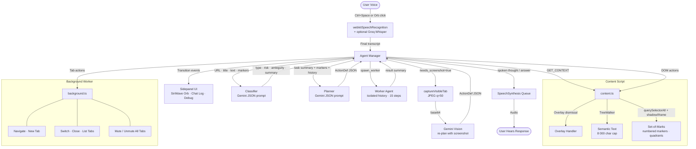

<div align="center">
  
  <h1>Lucy</h1>
  <p><b>Voice-first Browser Assistant</b></p>
  <p>An AI-powered browser assistant that helps users navigate the web using natural voice interaction.</p>
  
  <br />
  <a href="https://lucyx.vercel.app/">
    
  </a>
  <br />
</div>

---

## Overview

Lucy is a Chrome/Edge extension that lets you browse the web entirely by voice. You speak; Lucy classifies your intent, extracts the current page's interactive structure, asks Gemini for an action plan, executes it directly in the browser, and speaks the result back to you.

It was built as an accessibility-first project. Traditional screen readers narrate the DOM sequentially. Lucy acts on it — autonomously clicking, typing, scrolling, navigating, and managing tabs on your behalf after a single natural-language command.

---

## Why I Built This

Traditional assistive technology treats the web as a document to be read. I wanted to explore whether an AI agent could treat it as an environment to be acted on — understanding layout and intent, handling multi-step tasks, and recovering from failures without user intervention.

The interesting engineering is not just in calling an LLM; it is in managing state deterministically, grounding the model in real DOM context without flooding its token window, and keeping the voice loop fast enough to feel conversational.

---

## Features

**Core**
- Full voice control — speak to navigate, click, type, scroll, manage tabs
- Deterministic finite-state machine governing every agent transition
- Set-of-Marks DOM extraction: visible interactive elements numbered and spatially labeled for the model
- Semantic page text extraction via `TreeWalker` (headings, lists, body — no scripts or hidden nodes)
- Automatic modal and cookie banner dismissal before context is gathered
- Conditional multimodal vision — screenshots are only sent when the text planner explicitly requests them

**Intelligence**
- Two-stage LLM pipeline: a fast classifier for intent/risk, then a planner for step-by-step actions
- Intent classification includes phonetic STT correction (e.g. resolves speech artifacts before planning)
- High-risk actions (send email, financial transactions) are gated behind an explicit verbal confirmation
- Ambiguous commands trigger a clarifying question rather than a best-guess action
- Multi-agent delegation: coordinator can spawn a `WorkerAgent` for deep research subtasks
- Auto-localisation: search domains and URLs are adjusted to the user's detected country

**Memory**
- Short-term session history (`chrome.storage.session`)
- Long-term persistent memory (`chrome.storage.local`) that survives browser restarts
- Automatic summarisation and compression via Gemini when history exceeds thresholds

**Speech**
- Primary STT: browser-native `webkitSpeechRecognition` with live interim transcripts
- Optional enhanced STT: Groq `whisper-large-v3-turbo` — activate by providing a Groq API key in Settings
- TTS: browser-native `SpeechSynthesis`, with automatic selection of natural voices (`Google US English`, `Microsoft Zira`, or system default)
- Audio ducking: all other browser tabs are muted while the microphone is active

---

## Architecture



---

## How It Works

### 1. Voice Capture

Pressing `Ctrl+Space` (or clicking the orb) starts `webkitSpeechRecognition` in continuous mode. Interim transcripts appear in the chat log in real time. If a Groq API key is configured, a `MediaRecorder` also captures the raw audio; on utterance completion the audio is posted to Groq's Whisper endpoint and its higher-accuracy transcript is used instead.

### 2. Intent Classification

The transcript, current URL, page title, and the last four turns of conversation history are sent to Gemini with a structured classifier prompt. The model returns a JSON object:

```json
{
  "type": "task | generic | confirmation | cancellation",
  "risk": "low | high",
  "ambiguity": "clear | ambiguous",
  "summary": "Open the first search result",
  "clarification_question": null
}
```

`generic` goes straight to a conversational response. `high` risk pauses for verbal confirmation. `ambiguous` asks the clarification question. `task` enters the planning loop.

### 3. State Machine

Every transition in the agent is validated against a whitelist. Invalid transitions are logged and rejected. The 12 states:

`IDLE → LISTENING → TRANSCRIBING → CLASSIFYING → PLANNING → EXECUTING → REPLANNING → RECOVERING → COMPLETE`

…plus `RESPONDING`, `WAITING_FOR_REPLY`, and `WAITING_FOR_WORKER`.

When exiting a busy state, an `AbortController` is signalled to cancel in-flight Gemini requests and DOM timers immediately. A 60-second timeout on `WAITING_FOR_REPLY` resets the machine if the user does not respond.

### 4. DOM Context — Set of Marks

Before calling the planner, the content script runs three passes:

1. **Overlay dismissal** — tries Escape, close-button selectors, and backdrop click.
2. **Semantic text** — a `TreeWalker` visits visible text nodes (skipping `script`, `style`, `svg`), formats headings and list items as Markdown, and truncates cleanly at 8 000 characters.
3. **Set-of-Marks** — queries buttons, links, inputs, selects, textareas, media elements, and ARIA roles. Each visible, non-disabled element is assigned an integer ID written to `data-agent-marker`. Spatial quadrant (Top/Center/Bottom × Left/Center/Right) is computed from `getBoundingClientRect`. Shadow DOM and same-origin iframes are traversed recursively.

The result sent to the planner looks like:

```
[1] a [Top Left] — "Home" → https://example.com/
[2] input (search) [Top Center] — "Search"
[3] button [Top Right] — "Sign in"
```

### 5. Action Planning

The planner prompt contains the task summary, URL, title, semantic text, markers list, and history. Gemini returns a single JSON action:

```json
{
  "action": "click",
  "target_id": 3,
  "thought": "Alright, I'll open the sign-in page for you.",
  "needs_screenshot": false
}
```

If `needs_screenshot` is `true`, the sidepanel captures a JPEG screenshot at 50% quality, and the planner is called again with the image attached as a multimodal `image_url` part — screenshots are never sent unconditionally.

### 6. Execution

Actions are routed by type:

- **Content Script** — `click`, `type`, `scroll_down/up`, `press_enter`, `press_key`, `media`, `wait`
- **Background Worker** — `navigate`, `go_back`, `new_tab`, `close_tab`, `switch_tab`, `list_tabs`

For `click`: scroll into view → focus → full pointer/mouse event cascade → `.click()`.  
For `type`: select-all (including Ctrl+A and `execCommand('selectAll')`) → `execCommand('insertText')` → native property-descriptor fallback for React/Vue-managed inputs → dispatch `input`, `change`, `keyup`.  
For `navigate`: update tab URL → wait for `status: complete` → inject a MutationObserver that resolves after 500 ms of DOM silence.

Three consecutive execution failures abort the task and inform the user.

### 7. Memory

History is maintained as a conversation array of `{ role, content }` pairs.

- Stored in `chrome.storage.session` each turn.
- When history exceeds 20 turns, the oldest 4 turns are summarised by Gemini into a sentence or two and stored in `chrome.storage.local` as a long-term memory entry.
- When long-term memories exceed 5 entries, all are compressed into a single master memory document.
- Long-term memories are prepended to every LLM call as a system message, so user preferences and context persist across browser sessions.

### 8. Worker Agent

For complex research tasks the planner can emit `spawn_worker`. This creates a `WorkerAgent` with its own fresh history and a 15-step budget. It runs the same plan-execute loop, communicates results back to the coordinator as an internal log entry, and the coordinator then formulates the final spoken answer. Workers cannot spawn further workers.

---

## Tech Stack

| Layer | Technology |
|---|---|
| Extension API | Chrome / Edge Manifest V3 |
| Language | TypeScript ~6.0.2 (ES2023) |
| Build | Vite 8 · `@crxjs/vite-plugin` |
| AI | Google Gemini (`gemini-3.1-flash-lite` default · `gemini-3.0-pro` optional) |
| AI Transport | Gemini OpenAI-compatible endpoint |
| Speech Input | `webkitSpeechRecognition` (primary) · Groq `whisper-large-v3-turbo` (optional) |
| Speech Output | `window.speechSynthesis` |
| Waveform | `siriwave` (iOS 9 style) |
| Storage | `chrome.storage.session` · `chrome.storage.local` |
| Styling | Vanilla CSS, glassmorphism, no framework |

---

## Getting Started

### Prerequisites

- Node.js 18+
- A Google Gemini API key — [Get one here](https://aistudio.google.com/apikey)
- (Optional) A Groq API key for higher-accuracy speech recognition

### Build

```bash
git clone https://github.com/imshreyaskn/lucy.git
cd lucy/voice-agent-extension
npm install
npm run build
```

The extension is output to the `dist/` directory.

### Load in Chrome or Edge

1. Go to `chrome://extensions` (or `edge://extensions`)
2. Enable **Developer mode**
3. Click **Load unpacked** and select the `dist/` folder
4. Press **Ctrl+Shift+Y** to open the Lucy sidepanel

### Configure

Open the **Settings** panel (sliders icon) and enter:

- **Gemini API Key** — required
- **Gemini Model** — `gemini-3.1-flash-lite` (default) or `gemini-3.0-pro`
- **Groq API Key** — optional; enables Whisper-based transcription
- **Vision** — toggle multimodal screenshot analysis on/off
- **Rate Limiting** — optional delay between API calls (useful on free-tier keys)

### Microphone Permission

If the microphone is denied, Lucy will open the **Permissions** page in a new tab. Click **Grant Microphone Permission** to trigger the browser's native permission dialog.

### Keyboard Shortcuts

| Shortcut | Action |
|---|---|
| `Ctrl+Shift+Y` | Open / close the Lucy sidepanel |
| `Ctrl+Space` | Toggle push-to-talk |

---

## Project Structure

```
voice-agent-extension/
├── manifest.json               # MV3 extension manifest
├── package.json
├── vite.config.ts
├── tsconfig.json
├── public/
│   ├── icon.png
│   └── rules.json              # Declarative net request rules (Edge speech WS header)
└── src/
    ├── background/
    │   └── background.ts       # Service worker: tab ops, hotkeys, audio ducking
    ├── content/
    │   └── content.ts          # Content script: context extraction, action dispatch
    ├── lib/
    │   ├── agent-manager.ts    # Coordinator: orchestrates the full agent loop
    │   ├── classifying.ts      # First-stage Gemini call: intent + risk + ambiguity
    │   ├── planning.ts         # Second-stage Gemini call: single atomic action
    │   ├── state-machine.ts    # Deterministic FSM with whitelisted transitions
    │   ├── worker-agent.ts     # Isolated sub-agent for multi-step subtasks
    │   ├── history-manager.ts  # Dual-tier memory with LLM-driven compaction
    │   ├── litellm-client.ts   # Gemini API client, task queue, vision support
    │   ├── markers.ts          # Set-of-Marks extraction (shadow DOM + iframe aware)
    │   ├── page-context.ts     # TreeWalker semantic text + page metadata
    │   ├── overlay-handler.ts  # Modal / cookie banner dismissal
    │   ├── dom-utils.ts        # fillInput, waitForDomSettle, sleep, isVisible
    │   ├── speaker.ts          # SpeechSynthesis queue with voice selection
    │   ├── system-prompt.ts    # System prompt builders + background context
    │   ├── ip-location.ts      # IP geolocation for auto-localisation
    │   └── logger.ts           # Circular in-memory log, emits agent-log DOM events
    ├── sidepanel/
    │   ├── index.html          # Main extension UI
    │   ├── sidepanel.ts        # UI controller, SiriWave, STT pipeline
    │   └── sidepanel.css       # Glassmorphism layout and states
    ├── options/
    │   ├── options.html
    │   └── options.ts          # Microphone permission onboarding
    └── landing/
        ├── index.html          # Product landing page
        ├── landing.css
        └── landing.js          # Physics orb, SVG state machine diagram
```

---

## Example Usage

```
"Hey Lucy, search for mechanical keyboards under $100 on Amazon"
→ Navigates to amazon.com/in (auto-localised), types the query, submits

"Read me the headline and first paragraph"
→ Extracts semantic text, answers via TTS without browser action

"Scroll down a bit, then click the second result"
→ Two-step task: scroll action, re-extract markers, click action

"Go back and try the next result"
→ Calls chrome.tabs.goBack(), re-extracts context, clicks next

"Play the video on this page"
→ Queries all <video> elements, calls .play() natively

"What tabs do I have open?"
→ list_tabs action returns tab list; Lucy reads them aloud

"Close this tab and switch to the YouTube one"
→ Multi-step: close_tab, switch_tab
```

---

## Roadmap

**Implemented**
- [x] Voice interaction with push-to-talk and full audio pipeline
- [x] Autonomous multi-step browser automation
- [x] Dual-tier persistent memory with LLM compaction
- [x] Multimodal vision (conditional screenshots)
- [x] Multi-agent task delegation (WorkerAgent)
- [x] Set-of-Marks DOM grounding with shadow DOM and iframe traversal
- [x] Automatic overlay and cookie banner dismissal
- [x] Intent risk assessment and verbal confirmation gate

**Planned**
- [ ] Firefox / Safari support
- [ ] Offline / local LLM fallback
- [ ] Cross-session persistent user profile (name, preferences, shortcuts)
- [ ] Multi-agent parallelism (concurrent workers)

---

## Lessons Learned

- **Deterministic state machines earn their boilerplate.** A transition whitelist surfaces impossible states as bugs during development rather than as silent runtime failures in production.
- **DOM grounding matters more than prompt length.** Sending a compact numbered marker list with spatial metadata outperforms sending raw HTML by a large margin — fewer tokens, fewer hallucinated element IDs.
- **Phonetic STT correction needs to happen in the classifier, not the planner.** The classifier has enough context (URL, page title, history) to resolve ambiguous speech artifacts before they propagate into actions.
- **Screenshots should be conditional, not default.** Sending a base64 image on every step adds ~200 ms and significant token cost. Letting the model self-request a screenshot only when it needs one keeps the loop fast.
- **Chrome's `speechSynthesis` will drop utterances silently** if you call it while a previous one is still queued. A serialised FIFO queue is non-negotiable.

---

## License

MIT
