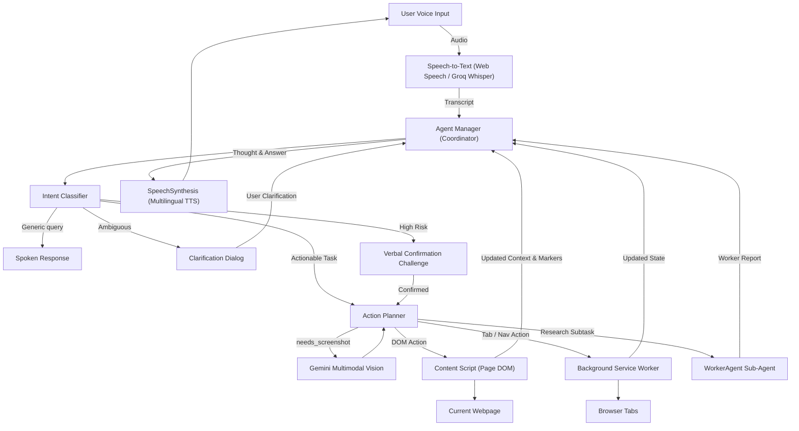

<div align="center">
  

  <h1>ANVORA</h1>
  <h3>AUTONOMOUS INTELLIGENCE</h3>

  <p><b>Connected Intelligence. Autonomous Action.</b></p>

  <p>
    A multilingual, voice-first autonomous browser assistant engineered for intelligent webpage comprehension,
    natural voice interaction, and hands-free web exploration.
  </p>

  <br />
</div>

---

## Overview

**ANVORA** is an autonomous browser assistant designed for Chromium-based browsers (Google Chrome, Microsoft Edge, Brave).

Speak to ANVORA naturally in **English**, **Hindi**, or **Telugu** (experimental). ANVORA understands your intent, parses the relevant semantics of the active webpage, formulates an action plan, and autonomously executes clicks, typing, navigation, tab management, and media interactions directly inside your browser.

ANVORA was built with accessibility, trust, and transparency at its core — designed for visually impaired individuals, users who struggle with conventional input devices, and anyone seeking a hands-free, autonomous web experience.

> **Heritage & Attribution:** ANVORA is developed as an evolution of the open-source *Lucy* browser assistant created by Shreyas (MIT License), retaining its rock-solid deterministic architecture while introducing a refined identity, multilingual capabilities, and enhanced accessibility controls.

---

## Core Capabilities

- **Autonomous Web Automation:** Multi-step browsing (navigating, typing, clicking buttons, submitting forms, scrolling, switching tabs).
- **Multilingual Voice Interaction:**
  - **English:** Full STT, TTS, and reasoning.
  - **Hindi (हिन्दी):** Voice input, native TTS voice selection, and Devanagari conversational reasoning.
  - **Telugu (తెలుగు):** Voice input, regional voice mapping, and conversational reasoning (*Experimental*).
- **Intelligent Page Grounding (Set-of-Marks):** Numbers interactive elements into spatial quadrants (Top/Center/Bottom × Left/Center/Right) rather than flooding LLMs with raw HTML.
- **Semantic Text Extraction:** Employs a custom `TreeWalker` to extract structured headings, paragraphs, and list items (up to 8,000 characters) while filtering invisible nodes and scripts.
- **Multimodal Visual Verification:** Automatically takes high-efficiency screenshots (`chrome.tabs.captureVisibleTab`) and queries Gemini Vision when visual inspection or layout confirmation is required.
- **Deterministic Finite-State Machine (FSM):** 12 explicit states with strict transition whitelists, preventing runaway loops and ensuring predictable execution.
- **Safety & Intent Classification:** Pre-flight classification classifies risk (high vs low) and ambiguity, prompting verbal confirmation for sensitive actions (e.g. transactions, account changes).
- **Dual-Tier Memory & Autonomous Compaction:** Session storage for active turns (`chrome.storage.session`) plus persistent long-term memories (`chrome.storage.local`) compacted via background LLM summarization.
- **Accessibility & Liquid Glass Interface:**
  - High Contrast Mode toggle.
  - Interface text size control (Normal, Large, Extra Large).
  - Speech rate regulation (0.8x – 1.4x).
  - Dynamic audio waveform visualization (SiriWave).
  - Tab audio ducking during speech recording.

---

## System Architecture



---

## Getting Started on Windows

### Prerequisites

- **Node.js** (v18 or higher)
- **npm** (bundled with Node.js)
- **Google Chrome** or **Microsoft Edge**
- **Google Gemini API Key** (obtain free from [ai.google.dev](https://ai.google.dev/))
- *(Optional)* **Groq API Key** for Whisper STT (from [groq.com](https://groq.com/))

### Installation & Build

```powershell
# 1. Clone or navigate to the repository
cd c:\Users\amog2\Desktop\lucy

# 2. Install dependencies
npm install

# 3. Build production bundle
npm run build
```

This compiles TypeScript and builds the extension bundle into the `dist/` directory via Vite and `@crxjs/vite-plugin`.

### Loading into Browser

1. Open your browser and navigate to `chrome://extensions/` (or `edge://extensions/`).
2. Toggle **Developer mode** on in the top-right corner.
3. Click **Load unpacked**.
4. Select the `dist/` folder inside the project directory.
5. The **ANVORA** extension icon will appear in your browser toolbar.

### First-Time Configuration

1. Click the ANVORA toolbar icon or press `Ctrl+Shift+Y` to open the side panel.
2. Click the **Settings** (sliders icon) in the header.
3. Choose your preferred **Assistant Language** (English, Hindi, or Telugu).
4. Enter your **Gemini API Key**.
5. Adjust **Voice Speed** and **Interface Text Size** if desired.
6. Click **Save Settings**.
7. Press `Ctrl+Space` or click the glowing orb to begin speaking!

---

## State Machine Reference

```text
IDLE ──► LISTENING ──► TRANSCRIBING ──► CLASSIFYING
                                             │
                       ┌─────────────────────┼─────────────────────┐
                       ▼                     ▼                     ▼
                  RESPONDING              PLANNING         WAITING_FOR_REPLY
                       │                     │                     │
                       └──────────────►  EXECUTING ◄───────────────┘
                                             │
                                     ┌───────┴───────┐
                                     ▼               ▼
                                 COMPLETE        REPLANNING ──► RECOVERING
```

---

## License

This project is licensed under the [MIT License](LICENSE).
Original architecture and core engine credited to Shreyas (Lucy).
Rebranded and extended as **ANVORA: Autonomous Intelligence**.
