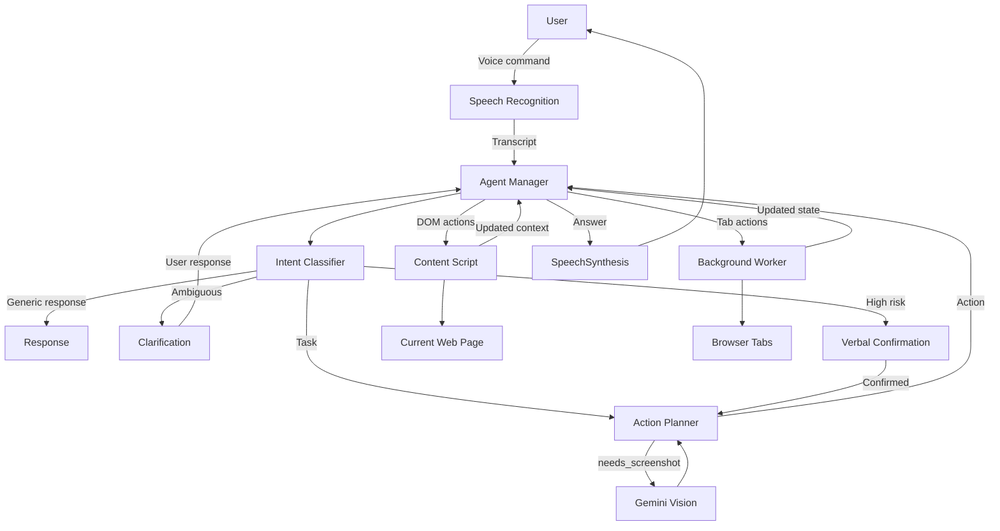
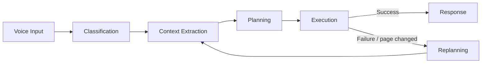
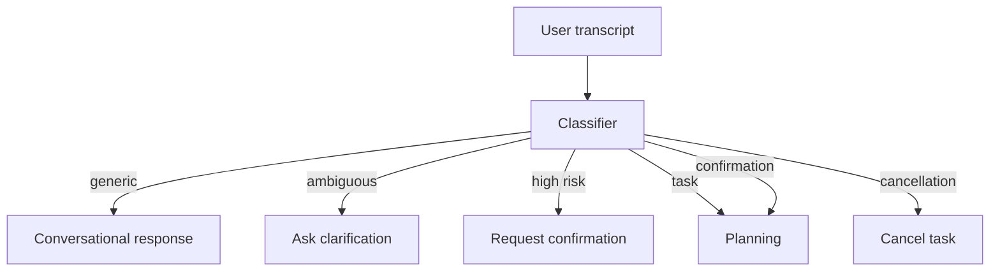
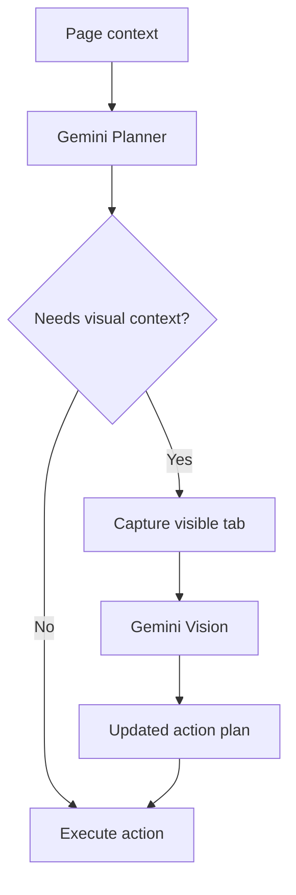
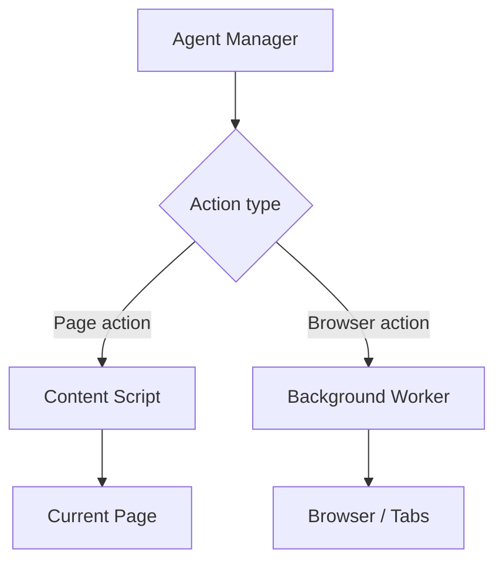
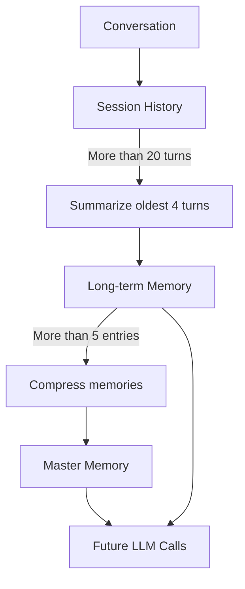
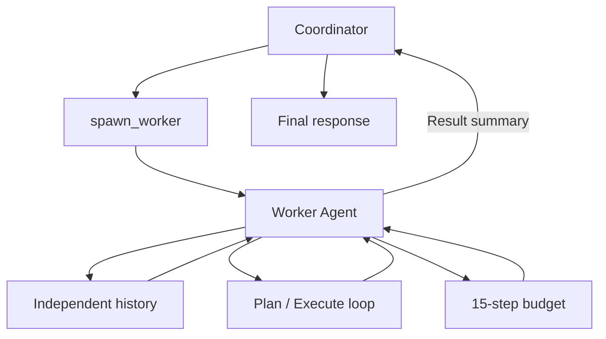
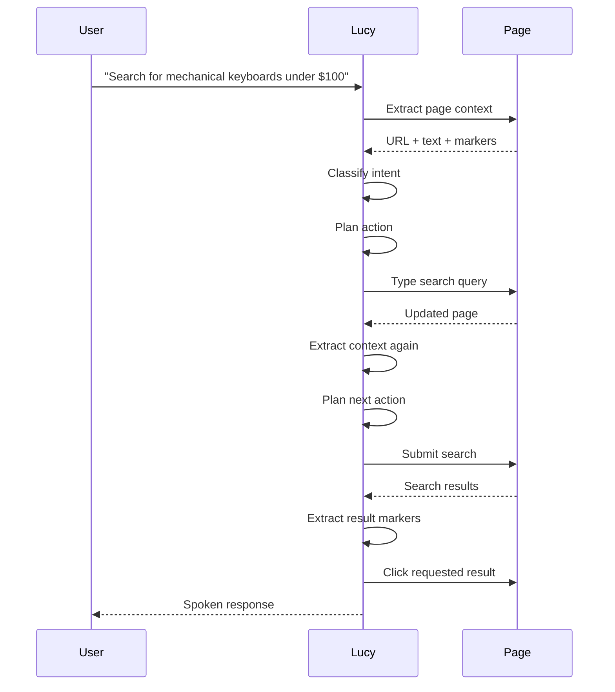

<div align="center">
  

  <h1>Lucy</h1>

  <p><b>Voice-first Browser Assistant</b></p>

  <p>
    An AI browser assistant that lets you navigate and interact with the web
    through natural voice commands.
  </p>

  <br />

  <a href="https://lucyx.vercel.app/">
    
  </a>

  <br />
</div>

## Overview

Lucy is a Chrome/Edge extension that lets you interact with websites through voice.

You give Lucy a natural-language command. It figures out what you mean, reads the relevant parts of the current page, plans an action, and executes it directly in the browser.

It can click, type, scroll, navigate between pages and tabs, read page content, interact with media, and handle multi-step tasks.

Lucy was built with accessibility in mind, particularly for users who may have difficulty interacting with conventional visual interfaces. Instead of treating a webpage as something that can only be read, Lucy treats it as an environment that can be understood and acted on.

---

## How It Works



The agent loop is deliberately split into separate stages rather than making one large LLM call.



---

## The Agent

Lucy is coordinated by an `AgentManager` backed by a deterministic finite-state machine.

The state machine currently includes:

```text
IDLE
LISTENING
TRANSCRIBING
CLASSIFYING
PLANNING
EXECUTING
REPLANNING
RECOVERING
RESPONDING
WAITING_FOR_REPLY
WAITING_FOR_WORKER
COMPLETE
```

Transitions are explicitly whitelisted. Invalid transitions are rejected rather than allowing the agent to drift into an undefined state.

When a busy operation finishes, Lucy also cancels outstanding Gemini requests and DOM timers through an `AbortController`.

A `WAITING_FOR_REPLY` timeout prevents the agent from remaining indefinitely in a waiting state.

---

## Page Understanding

Lucy does not send raw HTML to the model.

Before planning an action, the content script builds a compact representation of the current page.

### Semantic Text

A `TreeWalker` traverses visible text nodes while ignoring elements such as:

* `script`
* `style`
* `svg`
* hidden content

Headings and list items are represented as structured text and the result is capped at 8,000 characters.

### Set of Marks

Interactive elements are converted into numbered markers.

For example:

```text
[1] a [Top Left] — "Home"
[2] input [Top Center] — "Search"
[3] button [Top Right] — "Sign in"
```

The extraction process considers:

* buttons
* links
* inputs
* selects
* textareas
* media elements
* ARIA roles

Each visible element receives an ID through `data-agent-marker`.

Lucy also records the element's approximate screen position using a 3 × 3 spatial grid:

```text
Top    | Center | Bottom
Left   | Center | Right
```

Shadow DOM and same-origin iframes are traversed recursively.

This gives the model something much smaller and more useful than a page's raw DOM.

---

## Two-Stage Reasoning

Lucy uses two separate Gemini calls for task handling.

### 1. Classification

The first call determines what the user is trying to do.

It considers:

* transcript
* current URL
* page title
* recent conversation history

The classifier returns structured information about:

* intent type
* risk
* ambiguity
* task summary
* clarification question

This allows Lucy to handle cases differently:



High-risk actions such as sending an email or performing a financial transaction require explicit verbal confirmation. Ambiguous requests result in a clarification question rather than an arbitrary guess.

### 2. Planning

For actual browser tasks, the second Gemini call receives:

* task summary
* URL
* page title
* semantic page text
* Set-of-Marks
* conversation history

It returns a single atomic action.

For example:

```json
{
  "action": "click",
  "target_id": 3,
  "thought": "Open the sign-in page.",
  "needs_screenshot": false
}
```

The agent then executes that action, gathers fresh context, and plans the next step if the task requires it.

---

## Vision

Lucy uses screenshots conditionally rather than attaching one to every model request.

The planner can request a screenshot by returning:

```json
{
  "needs_screenshot": true
}
```

When that happens, the extension captures the visible tab as a JPEG and sends it to Gemini as a multimodal input.



This keeps screenshots out of the normal planning path unless the model actually needs visual information.

---

## Browser Automation

Actions are split between the content script and the background service worker.

### Content Script

Handles actions on the current page:

* click
* type
* scroll
* press Enter
* keyboard input
* media control
* wait

### Background Worker

Handles browser-level actions:

* navigate
* go back
* open tab
* close tab
* switch tab
* list tabs



For example, clicking an element involves scrolling it into view, focusing it, dispatching the relevant pointer/mouse events, and triggering the click.

Typing uses multiple fallbacks so that inputs managed by frameworks such as React or Vue can still receive the change correctly.

Navigation waits for the new page to finish loading and then waits for DOM activity to settle before the next context extraction.

If three consecutive execution attempts fail, Lucy aborts the task and reports the failure to the user.

---

## Memory

Lucy maintains two levels of conversation memory.



### Session Memory

Recent conversation turns are stored in:

```text
chrome.storage.session
```

### Long-term Memory

When the conversation grows beyond the configured threshold, older turns are summarized by Gemini and stored in:

```text
chrome.storage.local
```

When the long-term memory grows beyond five entries, those memories are compressed into a single master document.

The resulting memory is prepended to future LLM calls, allowing preferences and useful context to survive browser restarts.

---

## Worker Agent

For larger research tasks, the planner can emit a `spawn_worker` action.

Lucy creates a separate `WorkerAgent` with:

* fresh conversation history
* its own execution loop
* a 15-step budget

The worker cannot spawn additional workers.

Once it finishes, it sends its result back to the coordinator, which uses that result to formulate the final response.



This keeps longer research tasks separate from the main conversation state.

---

## Speech

Lucy supports two speech-input paths.

### Speech-to-Text

The default path uses:

```text
webkitSpeechRecognition
```

It provides live interim transcripts while the user is speaking.

An optional Groq integration can capture the audio through `MediaRecorder` and send it to:

```text
whisper-large-v3-turbo
```

for enhanced transcription.

### Text-to-Speech

Responses are spoken using the browser's native:

```text
window.speechSynthesis
```

Lucy maintains a serialized speech queue so consecutive responses do not get dropped by the browser's speech synthesis implementation.

When the microphone is active, Lucy also ducks audio from other browser tabs.

---

## Tech Stack

| Layer              | Technology                                       |
| ------------------ | ------------------------------------------------ |
| Extension          | Chrome /      Manifest V3                        |
| Language           | TypeScript                                       |
| Build              | Vite, `@crxjs/vite-plugin`                       |
| AI                 | Google Gemini                                    |
| Optional STT       | Groq Whisper                                     |
| Speech Output      | Web Speech API                                   |
| Browser Automation | Chrome Extension APIs                            |
| Storage            | `chrome.storage.session`, `chrome.storage.local` |
| Styling            | Vanilla CSS                                      |

The current configuration uses `gemini-3.1-flash-lite` by default with `gemini-3.0-pro` available as an alternative.

---

## Getting Started

### Prerequisites

* Node.js 18+
* Google Gemini API key
* Chrome or Edge

Optional:

* Groq API key for Whisper-based transcription

### Build

```bash
git clone https://github.com/imshreyaskn/lucy.git

cd lucy/voice-agent-extension

npm install

npm run build
```

The built extension will be available in:

```text
dist/
```

### Load the Extension

1. Open `chrome://extensions` or `edge://extensions`.
2. Enable **Developer mode**.
3. Select **Load unpacked**.
4. Choose the `dist/` directory.
5. Open Lucy with `Ctrl+Shift+Y`.

---

## Configuration

Open Lucy's Settings panel and configure:

| Setting        | Description                                  |
| -------------- | -------------------------------------------- |
| Gemini API Key | Required for classification and planning     |
| Gemini Model   | `gemini-3.1-flash-lite` or `gemini-3.0-pro`  |
| Groq API Key   | Optional enhanced speech recognition         |
| Vision         | Enables screenshot-based multimodal planning |
| Rate Limiting  | Adds a delay between API calls               |

---

## Keyboard Shortcuts

| Shortcut           | Action              |
| ------------------ | ------------------- |
| `Ctrl + Shift + Y` | Open / close Lucy   |
| `Ctrl + Space`     | Toggle push-to-talk |

---

## Project Structure

```text
voice-agent-extension/
├── manifest.json
├── package.json
├── vite.config.ts
├── tsconfig.json
│
├── public/
│   ├── icon.png
│   └── rules.json
│
└── src/
    ├── background/
    │   └── background.ts
    │
    ├── content/
    │   └── content.ts
    │
    ├── lib/
    │   ├── agent-manager.ts
    │   ├── classifying.ts
    │   ├── planning.ts
    │   ├── state-machine.ts
    │   ├── worker-agent.ts
    │   ├── history-manager.ts
    │   ├── litellm-client.ts
    │   ├── markers.ts
    │   ├── page-context.ts
    │   ├── overlay-handler.ts
    │   ├── dom-utils.ts
    │   ├── speaker.ts
    │   ├── system-prompt.ts
    │   ├── ip-location.ts
    │   └── logger.ts
    │
    ├── sidepanel/
    │   ├── index.html
    │   ├── sidepanel.ts
    │   └── sidepanel.css
    │
    ├── options/
    │   ├── options.html
    │   └── options.ts
    │
    └── landing/
        ├── index.html
        ├── landing.css
        └── landing.js
```

The main pieces are:

* `agent-manager.ts` — coordinates the agent loop
* `state-machine.ts` — controls valid state transitions
* `classifying.ts` — first-stage intent/risk classification
* `planning.ts` — action planning
* `markers.ts` — Set-of-Marks extraction
* `page-context.ts` — semantic page extraction
* `worker-agent.ts` — isolated research worker
* `history-manager.ts` — session and long-term memory
* `litellm-client.ts` — Gemini client and vision support
* `content.ts` — DOM interaction and context extraction
* `background.ts` — browser/tab operations

---

## Example Commands

Lucy is designed around natural language rather than predefined commands.

```text
"Search for mechanical keyboards under $100 on Amazon."

"Read me the headline and first paragraph."

"Scroll down a bit, then click the second result."

"Go back and try the next result."

"Play the video on this page."

"What tabs do I have open?"

"Close this tab and switch to the YouTube one."
```

These can result in anything from a single action to a multi-step browser task.

---

## A Multi-step Task

For example:



The important part is that Lucy does not assume the page remains unchanged after every action.

After navigation or interaction, it can gather fresh context and re-plan from the new state.

---

## Accessibility

Lucy was built around the idea that a browser should be something a user can interact with conversationally rather than only through visual controls.

The assistant can:

* Read page content aloud
* Navigate websites using voice
* Find and activate interactive elements
* Fill forms
* Scroll through pages
* Manage browser tabs
* Ask for clarification when a command is ambiguous
* Ask for confirmation before high-risk actions
* Continue multi-step tasks without requiring the user to manually direct every click

The goal is not to replace existing accessibility tooling, but to explore a different interaction model for the web.

---

## Design Decisions

### DOM grounding instead of raw HTML

Sending an entire DOM tree to an LLM is expensive and makes it harder to reliably refer to interactive elements.

Lucy instead produces a compact representation containing:

* semantic text
* numbered interactive elements
* element types
* labels
* URLs
* spatial information

This gives the planner a much smaller action space.

### Classification before planning

A single prompt that both understands intent and executes actions makes it difficult to handle ambiguity and risk.

Lucy separates the two:

```text
User input
    ↓
Classification
    ↓
Risk / ambiguity check
    ↓
Planning
    ↓
Execution
```

This lets the system stop before execution when confirmation or clarification is required.

### Screenshots on demand

Most browser actions can be grounded using DOM information.

Screenshots are therefore requested only when the planner decides visual information is necessary.

### Deterministic state management

The LLM decides what to do.

The state machine decides **whether the agent is allowed to do it next**.

That separation keeps the orchestration logic predictable even though the model's output is probabilistic.

---

## Current Scope

Implemented:

* Voice-controlled browser interaction
* Multi-step browser automation
* DOM grounding with Set-of-Marks
* Semantic page extraction
* Shadow DOM and same-origin iframe traversal
* Conditional screenshot-based vision
* Intent, risk, and ambiguity classification
* Verbal confirmation for high-risk actions
* Session memory
* Persistent memory with LLM compaction
* Worker-agent delegation
* Automatic modal/cookie-banner dismissal
* Browser tab management
* Speech output

Planned:

* Firefox / Safari support
* Offline or local LLM fallback
* Persistent user profile
* Parallel worker agents

---

## Lessons Learned

Building Lucy made a few things particularly clear.

**Grounding matters more than prompt length.**

A compact representation of the page with numbered elements and spatial metadata is much easier for the model to reason about than raw HTML.

**State machines are worth the boilerplate.**

When an LLM is involved, having explicit transitions makes it much easier to reason about what the system is allowed to do.

**Vision should be conditional.**

Sending screenshots on every step adds unnecessary latency and token usage. Most interactions can be handled from structured DOM context.

**Speech output needs its own queue.**

Browser speech synthesis can silently drop utterances when multiple calls are queued incorrectly, so serializing speech became necessary.

**The planner should not be trusted with orchestration.**

The model can propose an action, but the extension decides whether that action is valid, how it is executed, and when the next piece of context should be collected.

---

<p align="center">
  <i>Voice in. Intent understood. Browser controlled.</i>
</p>
